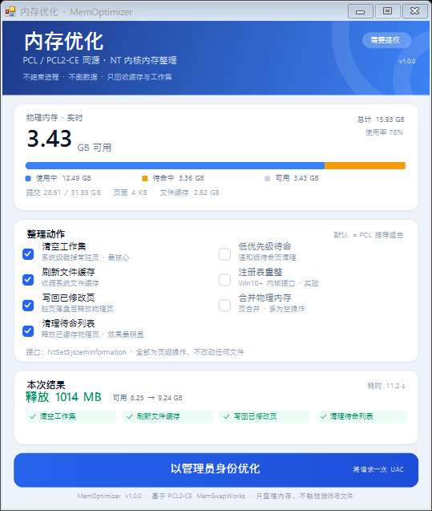

# 内存优化 · MemOptimizer

把 PCL2 / PCL2-CE「百宝箱 → 内存优化」单独拆出来的 Windows 小工具：44 KB 单文件、免安装、不联网、不需要驱动，只调用 NT 内核的内存整理接口。

> An independent, single-file Windows memory optimizer that reimplements the kernel calls behind PCL2-CE's `MemSwapWorks`. No installer, no driver, no network.

[](https://github.com/citie114514/MemOptimizer/actions/workflows/release.yml)


## 它和 PCL 是什么关系

- **PCL2 主线没有开源这部分**：官方仓库里百宝箱相关代码被隐去，只留下「为便于维护，开源内容中不包含百宝箱功能……」的提示。该功能自 2.6.3 起加入（作者 @idhaname），并支持 `PCL.exe --memory` 静默执行。
- **社区版 PCL2-CE 给了完整实现**：`PCL.Core/App/Tools/MemSwapService.cs` + `MemSwapWorks.cs`，用 ntdll 的 `NtSetSystemInformation` 依次执行 7 个内存整理动作，并通过提权子进程完成。
- **本工具按同一套调用和顺序重写**（C# / WinForms / .NET Framework 4.8），额外加了实时内存读数、逐项结果、JSON 报告和更安全的默认组合。默认动作 = PCL2-CE 的 `All` 去掉三个实验项。

参考：
- 讨论与线索：<https://github.com/Meloong-Git/PCL/discussions/6357>
- [MemSwapService.cs](https://github.com/PCL-Community/PCL-CE/blob/7b5c912ffa29ef5554d069e7605d3faa99238c4a/PCL.Core/App/Tools/MemSwapService.cs)
- [MemSwapWorks.cs](https://github.com/PCL-Community/PCL-CE/blob/7b5c912ffa29ef5554d069e7605d3faa99238c4a/PCL.Core/App/Tools/MemSwapWorks.cs)
- PCL 2.6.3 更新说明（新增内存优化、`--memory` 参数）：<https://www.minebbs.com/resources/pcl-plain-craft-launcher.4256/updates>

## 下载

- **最新版**：<https://github.com/citie114514/MemOptimizer/releases/latest> —— 推 `v*` tag 后由 GitHub Actions 自动构建，Release 说明里附 SHA256；
- **自己编译**：见文末「构建」，产物 `dist\MemOptimizer.exe`。

## 用法

拿到 `MemOptimizer.exe` 后双击：

1. 勾选要执行的动作（默认已选 4 项）；
2. 点「开始优化」；
3. 普通权限启动时会请求一次 UAC —— 提权子进程完成整理、写出 JSON 结果，再回传给界面显示；已用管理员运行时直接在界面里逐项显示。

界面里的数字每秒刷新；结果卡片是**本次运行的快照**，所以跑完后隔一段时间，顶部「实时可用内存」会比结果里的数字低，这是正常的。

### 命令行

| 参数 | 作用 |
| --- | --- |
| `--memory` / `-m` | 执行一次整理（需要时自动提权），完成后弹结果窗 |
| `--silent` | 不弹窗，结果只写控制台/报告文件 |
| `--scope=15` | 动作位掩码，见下表；默认 `15` |
| `--report=path.json` | 把完整结果写入 JSON |
| `--help` | 帮助 |

```bat
MemOptimizer.exe --memory --silent --report=D:\mem.json
```

`--memory` 与 PCL2 的同名参数语义一致，适合做快捷方式或开机脚本。

## 动作与内核接口

| 动作 | 内核调用 | 默认 |
| --- | --- | --- |
| 清空工作集 | `NtSetSystemInformation(SystemMemoryListInformation, MemoryEmptyWorkingSets=2)` | ✓ |
| 刷新文件缓存 | `NtSetSystemInformation(SystemFileCacheInformationEx, Min/MaxWorkingSet=MAX)` | ✓ |
| 写回已修改页 | `...MemoryFlushModifiedList=3` | ✓ |
| 清理待命列表 | `...MemoryPurgeStandbyList=4` | ✓ |
| 低优先级待命 | `...MemoryPurgeLowPriorityStandbyList=5` | ○ |
| 注册表重整 | `SystemRegistryReconciliationInformation=155` | ○ |
| 合并物理内存 | `SystemCombinePhysicalMemoryInformation=130` | ○ |

位掩码与 PCL2-CE 的 `MemSwapScope` 完全一致：`1 / 2 / 4 / 8 / 16 / 32 / 64`。

权限：`SeProfileSingleProcessPrivilege` + `SeIncreaseQuotaPrivilege`（管理员）。

## 实测（本机，2026-10-18）

环境：Windows 11 26200、16 GB、1920×1080@150%、页面文件在 SSD。

| 指标 | 优化前 | 优化后 |
| --- | --- | --- |
| 可用物理内存 | 8.25 GB | 9.24 GB（+0.99 GB） |
| 待命缓存 | 1.41 GB | 30.7 MB |
| 文件缓存 | 366 MB | 12.6 MB |
| 总耗时 | 11.2 s | |

逐项：清空工作集 1077 ms（+589 MB）→ 刷新文件缓存 2 ms（+17 MB）→ 写回已修改页 8005 ms（+582 MB）→ 清理待命列表 1202 ms（最终差值已包含它）。完整原始 JSON 见 [`docs/sample-report.json`](docs/sample-report.json)。<br>

之所以慢，是「写回已修改页」要把脏页刷到页面文件；如果只要快，可以取消勾选它，1～3 秒即可完成。

## 别神话它

`EmptyWorkingSet` 不是真的把内存还给了硬件，而是把进程的工作集页换出到页面文件：

- 优化后立刻切回被整理过的程序，可能出现一两秒卡顿（缺页重新读盘）；
- 清理待命列表相当于丢掉系统缓存，之后冷启动程序、打开大文件会变慢，SSD 上影响小；
- 收益在 8 GB 机器上明显，32 GB 机器基本无感；
- **不要频繁点**，一天一两次或启动大型游戏前用一次即可。

工具本身只做页级操作：不结束进程、不删文件、不改注册表、不联网。

## 构建

需求：.NET SDK（提供 Roslyn `csc.dll`）+ .NET Framework 4.8 引用程序集（Windows 自带或 VS 安装）。

```powershell
.\build.ps1
```

产物 `dist\MemOptimizer.exe`（约 44 KB，AnyCPU，目标 .NET Framework 4.8，无需安装额外运行时）。

脚本会自动找最新的 .NET SDK 和本机 4.8 参考程序集；找不到参考程序集时（例如干净的 CI 机器）会回退到 NuGet 官方包 `Microsoft.NETFramework.ReferenceAssemblies.net48`，所以 `-ReferenceAssemblies <路径>` 只在特殊环境下才需要。

### 自动构建与发布

[`.github/workflows/release.yml`](.github/workflows/release.yml)：

- `push` 到 `main`、PR、手动 `workflow_dispatch` → 只构建并上传 artifact（保留 30 天）；
- **推 `v*` tag → 构建 + 自动创建 Release 并把 `MemOptimizer.exe` 挂上去**（Release 说明含 SHA256）；tag 若已有 Release 则覆盖上传产物；
- 失败后直接点 GitHub 上的「Re-run jobs」即可，tag 上下文会保留。

发布新版本：

```bash
git tag v1.0.1 && git push origin v1.0.1
```

### 源码结构

| 文件 | 职责 |
| --- | --- |
| `src/Native.cs` | ntdll / kernel32 / psapi 的 P/Invoke、内存快照结构 |
| `src/Optimizer.cs` | 7 个动作的定义、顺序、执行与结果 |
| `src/Model.cs` | 快照、报告、JSON 读写（无第三方依赖） |
| `src/Elevation.cs` | 管理员检测、runas 提权子进程与结果回传 |
| `src/MainForm.cs` | 自绘 WinForms 界面（DPI 自适应、逐项进度） |
| `src/Util.cs` | 参数解析、格式化、控制台附加 |
| `src/app.manifest` | asInvoker + system DPI aware |
| `build.ps1` | 用 csc 直接编译出单文件 exe |

## 已知限制

- 内核整理必须管理员权限；普通权限只能看数据，点击时会请求提权。
- 「注册表重整」「合并物理内存」在不同 Windows 版本上可能返回 `STATUS_NOT_IMPLEMENTED` / `STATUS_INVALID_PARAMETER`，失败会逐项标红，不影响其它动作。
- 未在 ARM64 实机验证（AnyCPU 编译，理论上可在 .NET Framework ARM64 上运行）。

## 许可

MIT。PCL2 / PCL2-CE 的源码与商标归其作者所有；本仓库只做接口层面的独立实现，未包含其代码。

